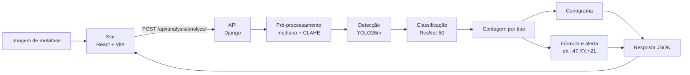
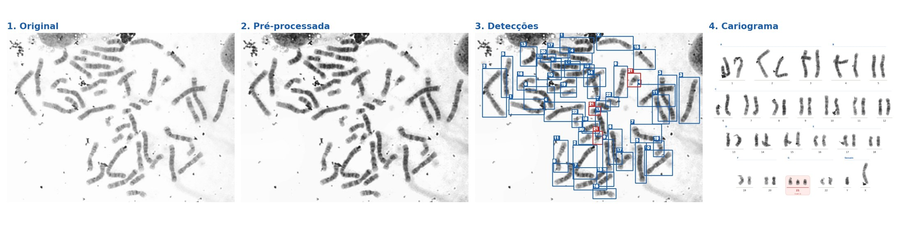
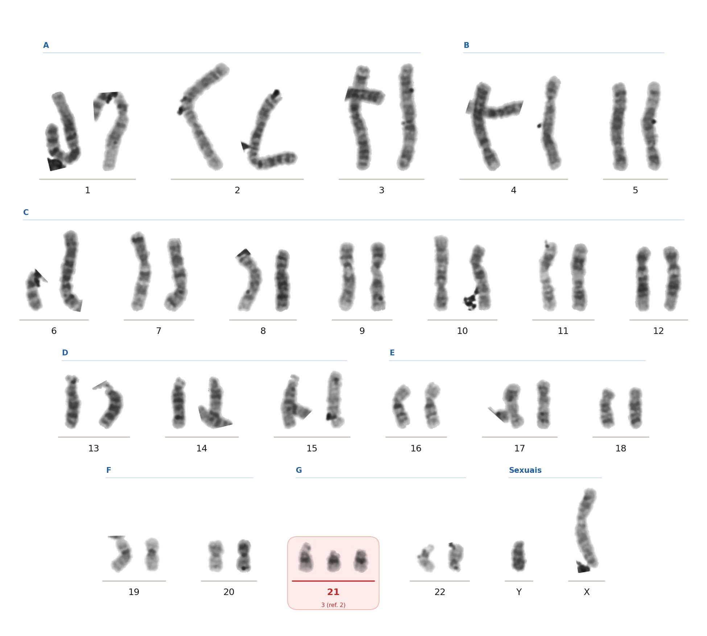

# CytoML Demo: Análise Automatizada de Cariótipos na Web

[](https://react.dev/)
[](https://vitejs.dev/)
[](https://tailwindcss.com/)
[](https://www.djangoproject.com/)
[](https://onnxruntime.ai/)
[](https://cloud.google.com/run)
[](https://vercel.com/)

CytoML Demo é a demonstração web da pipeline do [CytoML](https://github.com/irlvinicius/CytoML): a partir de uma imagem de metáfase, ela localiza cada cromossomo, identifica qual dos 24 tipos ele é (1 a 22, X e Y), monta o cariograma no formato do exame e sinaliza possíveis aneuploidias numéricas, como a trissomia do 21 (`47,XX,+21`).

**Acesse a demonstração:** [cytoml-demo.vercel.app](https://cytoml-demo.vercel.app)

## Visão Geral

Este repositório é a demonstração do Trabalho de Conclusão de Curso *Uso de Visão Computacional para Análise Automatizada de Cariótipos e Identificação de Aneuploidias* (UNIPÊ, 2026). O treinamento, a avaliação e os resultados estão no repositório [CytoML](https://github.com/irlvinicius/CytoML); aqui, a mesma pipeline roda atrás de uma API, com uma interface que mostra cada etapa da análise.

| Serviço | Endereço | Hospedagem |
|---|---|---|
| Demonstração | [cytoml-demo.vercel.app](https://cytoml-demo.vercel.app) | Vercel |
| Espelho | [cytoml-demo.onrender.com](https://cytoml-demo.onrender.com) | Render |
| API | [cytoml-api-762616154335.southamerica-east1.run.app](https://cytoml-api-762616154335.southamerica-east1.run.app/api/analysis/health/) | Google Cloud Run |

> [!TIP]
> A API pode levar alguns segundos para responder no primeiro acesso, enquanto o servidor
> é iniciado e carrega os modelos. As análises seguintes levam cerca de 2 segundos.

---

## O Problema

A pipeline do CytoML foi desenvolvida e avaliada em notebooks e scripts, que exigem o ambiente de treinamento, os dados e familiaridade com o código. Isso dificulta mostrar o resultado a quem não é da área de computação:

| Dificuldade | Consequência |
|---|---|
| A pipeline roda em notebooks, com PyTorch e GPU | Ver um resultado exige instalar o ambiente inteiro |
| A saída é um conjunto de tabelas e figuras | O cariograma e o alerta não aparecem juntos, no formato do exame |
| Cada etapa é avaliada separadamente | Fica difícil acompanhar a imagem passando de uma etapa para a outra |

---

## A Solução

A demonstração leva a pipeline do artigo para a web, sem alterar os modelos nem os parâmetros:

1. **API** -> um backend em Django recebe a imagem e roda a pipeline replicada do CytoML (`backend/apps/analysis/pipeline/`), com os dois modelos exportados para ONNX, sem PyTorch.
2. **Mesma entrada do artigo** -> a imagem é analisada como foi enviada, com o mesmo pré-processamento usado no treinamento (mediana + CLAHE).
3. **Interface** -> o site mostra cada etapa (original, pré-processada, detecções e cariograma), a fórmula do cariótipo e a contagem por par, com destaque para os pares fora do esperado.

---

## Fluxo da Aplicação



| <div align="center">Etapas da análise na metáfase 1055911 do conjunto de teste (47,XY,+21)</div> |
|---|
|  |

---

## Funcionalidades

* **Análise por upload** de uma imagem de metáfase (JPG, PNG, BMP, TIFF ou WEBP, até 10 MB), enviada sem redução nem recompressão.
* **Galeria de exemplos** com seis metáfases do conjunto de teste, nunca vistas no treinamento, incluindo a Figura 4 do artigo.
* **Resultado no formato do exame**: fórmula do cariótipo, selo de status, total de cromossomos, cromossomos sexuais e alterações por par, com os valores de referência.
* **Etapas em abas**: imagem original, pré-processada, detecções (com o número do par em cada caixa) e cariograma.
* **Visualizador em tela cheia** com o passo a passo da pipeline, zoom, navegação pelo teclado e, nas detecções, o tipo e as confianças de cada cromossomo ao passar o mouse.
* **Contagem por par** (1 a 22, X e Y) e o tempo de cada etapa da análise.

---

## Demonstração

Acesse em [cytoml-demo.vercel.app](https://cytoml-demo.vercel.app). Abaixo, o cariograma que a demonstração gera para uma das amostras da galeria.

| <div align="center">Cariograma gerado para a metáfase 1055911, com o alerta de trissomia do 21</div> |
|---|
|  |

---

## Como Usar

1. Acesse a [demonstração](https://cytoml-demo.vercel.app) (ou a versão local, em `http://localhost:5173`).
2. Em **Exemplos de Análise**, clique em uma das amostras: a imagem é enviada para a API e o resultado aparece no painel ao lado.
3. Em **Envie a Metáfase**, arraste uma imagem e clique em **Analisar Imagem**.
4. No resultado, navegue pelas abas e clique na imagem para abrir o visualizador em tela cheia.

| Status | O que significa |
|---|---|
| **Normal** | Dois cromossomos de cada autossomo e XX ou XY (46 no total) |
| **Alteração numérica** | Algum tipo fora do esperado, como uma trissomia (`47,XX,+21`) ou uma monossomia do X (`45,X`) |
| **Contagem inconsistente** | Total de 46, mas com um tipo a mais e outro a menos: provável erro de classificação, que pede revisão |
| **Sem cromossomos** | Nenhum cromossomo encontrado na imagem |

> O resultado é gerado automaticamente e serve apenas para fins acadêmicos. Ele não substitui a
> avaliação de um especialista em citogenética.

---

## API

| Método | Rota | Descrição |
|---|---|---|
| `GET` | `/api/analysis/health/` | Estado da API e se os modelos já foram carregados |
| `POST` | `/api/analysis/analyze/` | Analisa uma imagem (`multipart/form-data`, campo `image`) |

```bash
curl -F image=@metafase.jpg http://localhost:8080/api/analysis/analyze/
```

As respostas seguem o formato `{"success": ..., "data": ..., "error": ...}`. O campo `data` da análise traz (resumido):

```json
{
  "karyotype": {
    "formula": "47,XY,+21",
    "status": "alteração numérica",
    "status_code": "numerical",
    "findings": ["trissomia do 21 (Síndrome de Down)"],
    "total": 47,
    "counts": {"A1": 2, "G21": 3, "X": 1, "Y": 1},
    "alerts": {"G21": {"observed": 3, "expected": 2}}
  },
  "chromosomes": [
    {"id": 1, "bbox": [364.4, 84.5, 439.5, 178.3], "detection_confidence": 0.975,
     "class_name": "B4", "pair": "4", "class_probability": 0.999}
  ],
  "images": {
    "preprocessed": "data:image/jpeg;base64,...",
    "annotated": "data:image/jpeg;base64,...",
    "karyogram": "data:image/png;base64,..."
  },
  "timing_ms": {"preprocess": 80, "inference": 1200, "render": 400, "total": 1700},
  "model": {"detector": "YOLO26m (mediana + CLAHE)", "classifier": "ResNet-50", "detector_conf": 0.437},
  "warnings": []
}
```

Arquivos que não são imagens, ou que não podem ser lidos, retornam `400` com a mensagem do erro.

---

## Tecnologias

* **Site:** [React 19](https://react.dev/), [Vite 8](https://vitejs.dev/) e [Tailwind CSS 4](https://tailwindcss.com/)
* **API:** [Django 5.2](https://www.djangoproject.com/) + [Django REST Framework](https://www.django-rest-framework.org/), servida pelo [Gunicorn](https://gunicorn.org/)
* **Inferência:** [ONNX Runtime](https://onnxruntime.ai/) na CPU, [OpenCV](https://opencv.org/), [NumPy](https://numpy.org/) e [SciPy](https://scipy.org/)
* **Cariograma:** [Matplotlib](https://matplotlib.org/)
* **Modelos:** YOLO26m (detecção) e ResNet-50 (classificação), treinados no [CytoML](https://github.com/irlvinicius/CytoML)

---

## Estrutura do Projeto

```
cytoml-demo/
├── backend/
│   ├── apps/analysis/
│   │   ├── pipeline/          # Pipeline replicada do CytoML (pré-processamento, ONNX, cariótipo, cariograma)
│   │   ├── services/          # Carga dos modelos, análise de uma imagem e geração das imagens
│   │   ├── tests/             # Testes da pipeline e da API
│   │   └── views.py           # Rotas de análise e de health check
│   ├── cytoml_proj/           # Configurações do Django (CORS, SECRET_KEY, caminhos dos modelos)
│   ├── models/                # detector.onnx (YOLO26m) e classifier.onnx (ResNet-50)
│   ├── Dockerfile             # Imagem usada no Cloud Run
│   └── requirements.txt
├── frontend/
│   ├── public/samples/        # Metáfases do conjunto de teste usadas na galeria
│   └── src/
│       ├── components/        # Seções do site, resultado do cariótipo e visualizador em tela cheia
│       └── services/          # Cliente da API e formatação do resultado
├── docs/assets/               # Figuras deste README
├── docker-compose.yml         # Execução local do backend
└── .example.env               # Modelo das variáveis de ambiente
```

---

## Instalação e Execução

### 1. Pré-requisitos

* Linux, macOS ou Windows (testado no WSL2) e Git
* Python 3.12 ou [Docker](https://docs.docker.com/get-docker/), para a API
* [Node.js](https://nodejs.org/) 20 ou superior, para o site

### 2. Clonar o repositório

```bash
git clone https://github.com/PLeonLopes/cytoml-demo.git
cd cytoml-demo
```

Os dois modelos (`backend/models/*.onnx`, cerca de 175 MB) já vêm com o repositório.

### 3. Variáveis de ambiente

```bash
cp .example.env .env
```

| Variável | Descrição |
|---|---|
| `SECRET_KEY` | Chave do Django. Obrigatória com `DEBUG=False`; o `.example.env` mostra como gerar uma |
| `DEBUG` | `True` para desenvolvimento local |
| `ALLOWED_HOSTS` | Hosts aceitos pela API, separados por vírgula |
| `CORS_ALLOWED_ORIGINS` | Endereços do site que podem chamar a API (padrão: Vercel, Render e `localhost:5173`) |
| `DETECTOR_MODEL_PATH` / `CLASSIFIER_MODEL_PATH` | Caminhos dos modelos (padrão: `backend/models/`) |

### 4. Rodar a API

Com Docker:

```bash
docker compose up --build
```

Ou com um ambiente virtual:

```bash
cd backend
python3 -m venv .venv
source .venv/bin/activate        # <- Linux/macOS (no Windows: .venv\Scripts\activate)
pip install -r requirements.txt
DEBUG=True gunicorn cytoml_proj.wsgi:application --bind 127.0.0.1:8080 --threads 2 --timeout 120
```

A API fica disponível em `http://localhost:8080` (confira em `/api/analysis/health/`).

### 5. Rodar o site

```bash
cd frontend
npm install
VITE_API_URL=http://localhost:8080 npm run dev
```

O site abre em `http://localhost:5173`.

### 6. Testes

```bash
cd backend
DEBUG=True python manage.py test apps.analysis.tests    # pipeline e API, com os modelos reais

cd ../frontend
npm run lint
npm run build
```

---

## Autores

<div align="center">
  <table>
    <tr>
      <td align="center">
        <a href="https://github.com/PLeonLopes">
          <br />
          <sub><b>Pedro Nícollas Pereira Leon Lopes</b></sub>
        </a>
      </td>
      <td align="center">
        <a href="https://github.com/irlvinicius">
          <br />
          <sub><b>Vinícius Vieira de Lima</b></sub>
        </a>
      </td>
    </tr>
  </table>
</div>

<p align="center">
  <sub>UNIPÊ, Centro Universitário de João Pessoa</sub><br />
  <sub>Orientador: Prof. Maelso Bruno Pacheco Nunes Pereira</sub>
</p>
